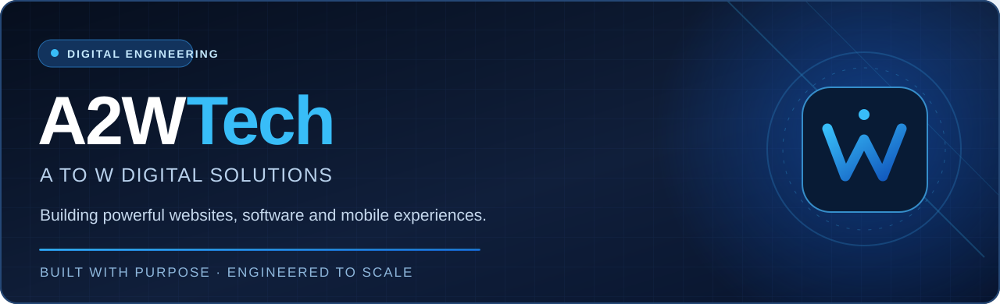

### Technology that works for your business.

**Software Engineering** · **Web Applications** · **Mobile Development** · **Digital Experiences**

<a href="https://www.a2wtech.com/"><strong>🌐 Visit our website</strong></a>
&nbsp;&nbsp;·&nbsp;&nbsp;
<a href="mailto:hello@a2wtech.com"><strong>💬 Let's talk</strong></a>
&nbsp;&nbsp;·&nbsp;&nbsp;
<a href="https://www.linkedin.com/company/a2wtech"><strong>💼 LinkedIn</strong></a>

---

## 👋 About A2WTech

**A2WTech (A to W Digital Solutions)** is a software and web development company founded in **2024** and based in **Batticaloa, Sri Lanka**. We help businesses turn their ideas and processes into thoughtfully designed, dependable digital products.

Our work spans business websites, custom web applications, mobile apps, search-ready experiences, visual design, and ongoing technical support. We collaborate with businesses in Sri Lanka and international teams through remote delivery.

We believe excellent software starts with **understanding the problem**, continues through **clear design and careful engineering**, and succeeds through **measurable, maintainable outcomes**.

## 🧩 What we build

<table>
<tr>
<td width="50%" valign="top">

### 🌐 Website Development
Responsive business websites built with speed, accessibility, and a polished user experience in mind.

[Explore website development →](https://www.a2wtech.com/services/website-development)

</td>
<td width="50%" valign="top">

### ⚙️ Web Applications
Custom business platforms, SaaS-style solutions, internal portals, workflow tools, and secure backends.

[Explore web applications →](https://www.a2wtech.com/services/web-application-development)

</td>
</tr>
<tr>
<td valign="top">

### 📱 Mobile Applications
Cross-platform and mobile-first applications designed around practical, intuitive workflows.

[Explore mobile development →](https://www.a2wtech.com/services/mobile-app-development)

</td>
<td valign="top">

### 🔎 SEO-Ready Websites
Technical SEO foundations, performance optimization, structured data, and discoverability-minded implementation.

[Explore SEO-friendly websites →](https://www.a2wtech.com/services/seo-friendly-websites)

</td>
</tr>
<tr>
<td valign="top">

### 🎨 Graphic & UI/UX Design
Brand visuals, thoughtful interfaces, and cohesive digital experiences.

[Explore design services →](https://www.a2wtech.com/services/graphic-design)

</td>
<td valign="top">

### 🛠️ Maintenance & Support
Post-launch improvements, performance monitoring, updates, and technical care.

[Explore maintenance services →](https://www.a2wtech.com/services/website-maintenance)

</td>
</tr>
</table>

## 💻 Engineering capabilities

We select tools according to product requirements and long-term maintainability, rather than using the same stack for every project.

| Area | Technologies and practices |
|:--|:--|
| **Web frontend** | HTML5, CSS3, JavaScript, responsive layouts, accessibility |
| **Application backends** | PHP, Laravel, Node.js, REST APIs, secure authentication |
| **Mobile** | Flutter and Dart |
| **Data** | MySQL, PostgreSQL, Firebase |
| **Delivery** | Git, CI/CD workflows, Vercel, HTTPS |
| **Discoverability** | Technical SEO, structured data, Core Web Vitals, AEO/GEO readiness |

## 🧭 How we approach projects

| 01 · Discover | 02 · Design | 03 · Develop | 04 · Deliver & improve |
|:--|:--|:--|:--|
| Understand goals and constraints | Map journeys and architecture | Build, review, and test | Launch, maintain, and iterate |

**What guides our work:** clear communication, clean and maintainable code, thoughtful user experience, and solutions aligned with real business needs.

## 🚀 What you'll find on our GitHub

This organization is intended as a home for A2WTech's **public engineering projects, reusable resources, and technical collaborations** as they become available. Some client or internal systems will remain private to protect confidentiality and intellectual property.

> Interested in our work? Visit our [website](https://www.a2wtech.com/) for services and ways to collaborate.

## 🤝 Work with us

Have a digital product to build, a website to improve, or an idea to explore? We'd be happy to hear what you're working on.

**Start a conversation with A2WTech**

[**📩 Email us**](mailto:hello@a2wtech.com) &nbsp;|&nbsp; [**💬 WhatsApp**](https://wa.me/94784453881) &nbsp;|&nbsp; [**🌐 Our website**](https://www.a2wtech.com/)

**Connect:** [LinkedIn](https://www.linkedin.com/company/a2wtech) · [Instagram](https://www.instagram.com/a2w_tech) · [Facebook](https://www.facebook.com/profile.php?id=61594703399594)

📍 Batticaloa, Sri Lanka · Working with clients locally and internationally

© A2WTech · A to W Digital Solutions

